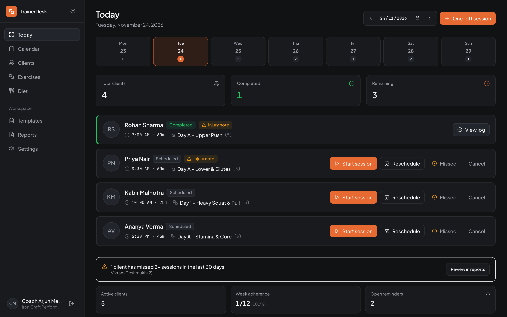
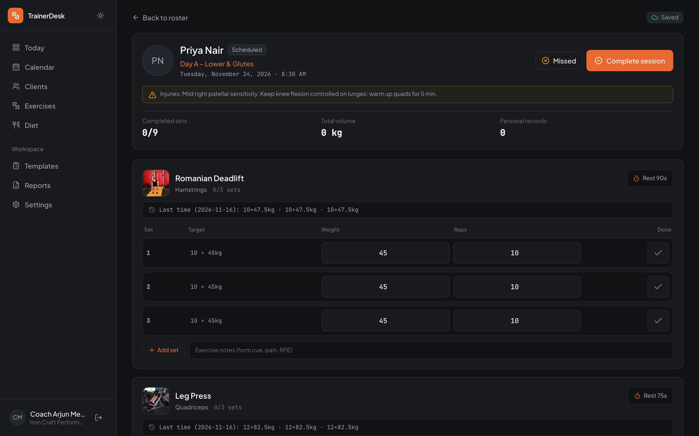
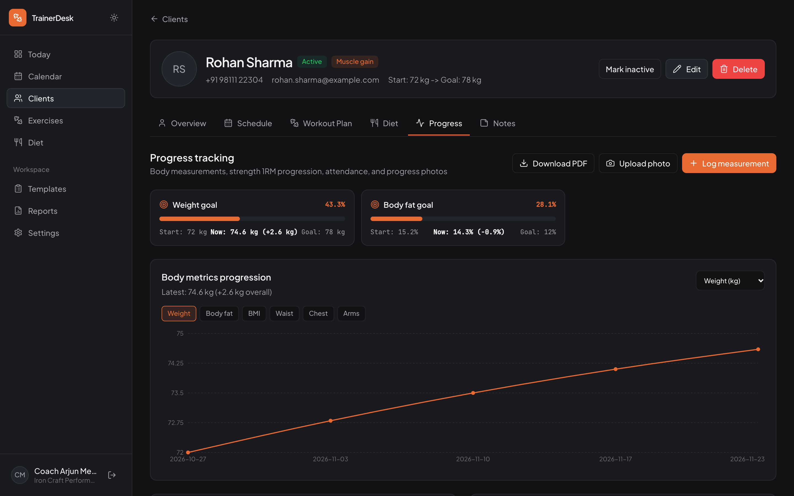
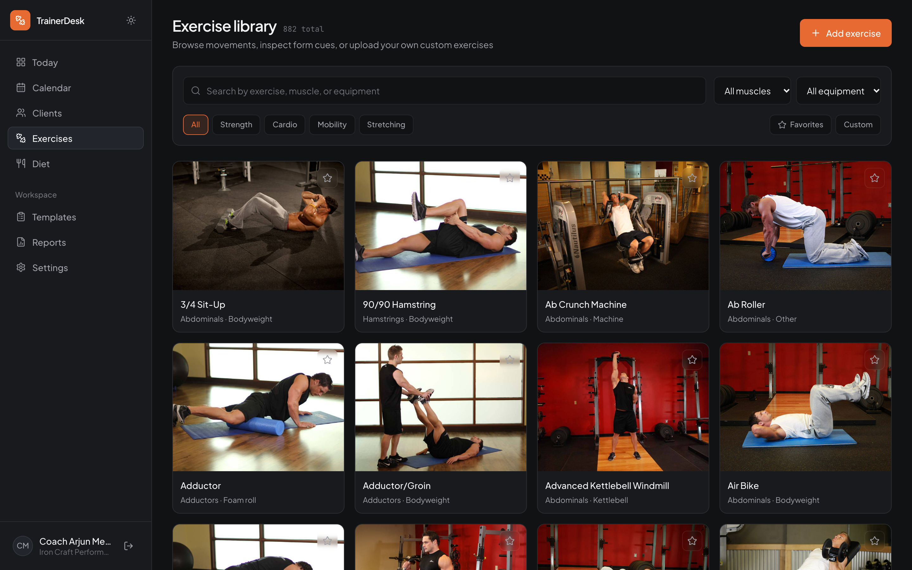
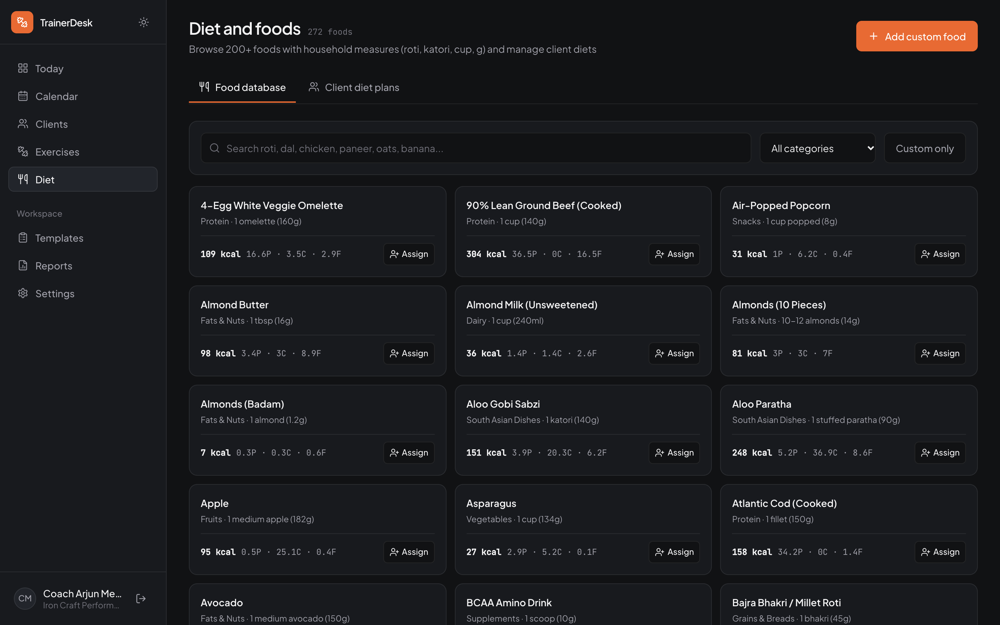
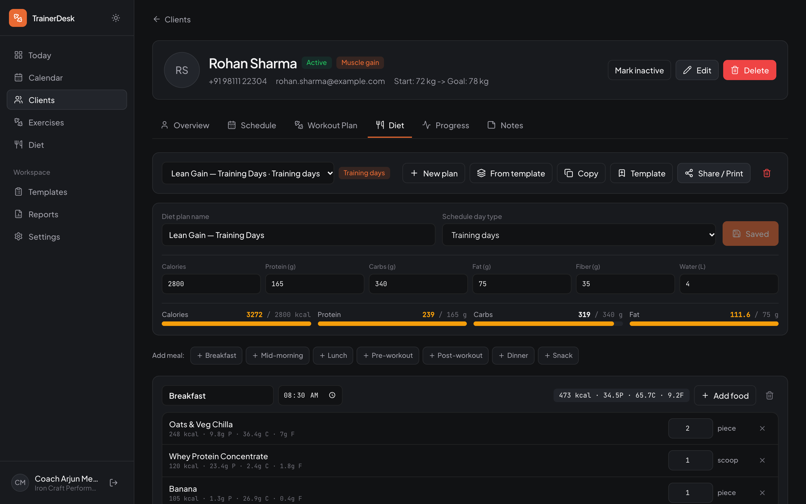
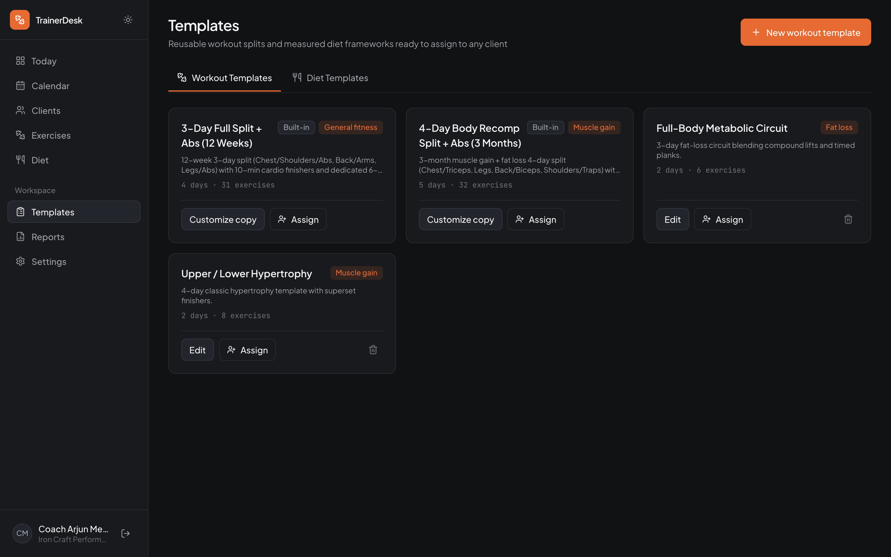
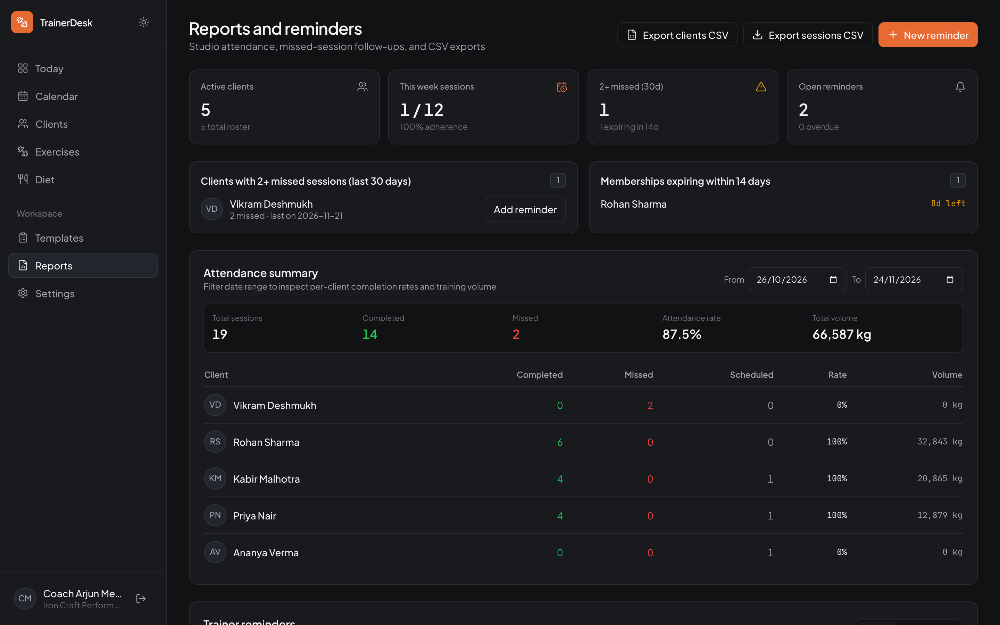

# TrainerDesk

**Personal Training OS — Daily Client Schedule, Live Workout Logger, Progress Analytics & Measured Diet Plans**

[](https://trainerdesk-psi.vercel.app)
[](#tech-stack)
[](docs/openapi.json)

TrainerDesk is a full-stack MERN (MongoDB, Express, React, Node.js) web application and installable PWA built for personal gym trainers managing multiple clients every day. Open it in the morning to see **who is scheduled today**, tap **Start session** to view prescribed sets/weights alongside `"Last time"` benchmarks, log sets live with automatic **PR detection** and a built-in rest timer, track long-term **body & strength progression**, and assign **measured diet plans** with shareable links and PDF exports.

> **Live Deployment:** [https://trainerdesk-psi.vercel.app](https://trainerdesk-psi.vercel.app)

---

## Screenshots

### Today Dashboard & Mon–Sun Week Strip
Instant morning view of today's clients sorted by session time, quick status chips, week client counts, missed-session alerts, and Studio Insights.



### Live Session Mode & Rest Timer
Touch-friendly set logging with `"Last time"` previous session performance, built-in countdown rest timer, automatic PR badges (`Max Weight`, `Est 1RM`, `Volume`), and offline auto-save queue.



### Progress Tracking, 1RM Charts & Consistency Heatmap
Auto-calculated BMI, goal completion cards, Recharts weight/body-fat/waist and Epley 1RM curves, 12-week attendance heatmap, pose-filtered Before/After photo slider, and downloadable PDF reports.



### 882-Exercise Visual Library
Full catalog from `free-exercise-db` plus gym-floor machine/cardio variants with images, search, muscle/equipment/category filters, favorites, and custom exercise uploads.



### Food Database with Direct Client Assignment
272 seeded foods (including South Asian staples with household measures: `g`, `ml`, `roti/piece`, `katori`, `cup`, `bowl`, `tbsp`, `scoop`), custom foods, and a 1-click **Assign** action directly onto any client's meal plan.



### Measured Client Diet Plans & Sharing
Training vs. rest day splits, live daily macro totals against targets, water & supplement notes, public read-only WhatsApp share links (`/share/diet/:shareToken`), and PDF exports.



### Built-In & Custom Workout / Diet Templates
Includes pre-seeded **3-Day Full Split + Abs (12 Weeks)** and **4-Day Body Recomp Split + Abs (3 Months)** templates plus custom workout & diet templates ready to assign or customize per client.



### Reports, Missed-Session Alerts & Reminders
Date-range attendance summaries, 2+ missed-session alerts, expiring membership tracking, neutralized CSV exports (`clients.csv` and `sessions.csv`), and trainer follow-up reminders.



---

## Core Features

### 1. Today Dashboard & Weekly Scheduling
- **Today Roster:** Client photo, name, time slot, linked workout day name, status (`Scheduled`, `In progress`, `Completed`, `Missed`), and quick **Start session** action.
- **Navigation & Week Strip:** Prev/Next day switcher, date picker, and Mon–Sun weekday strip showing scheduled client counts per day.
- **Flexible Recurring Rules:** Weekly recurring days + time + duration linked to a specific workout day, one-off sessions, and single-date reschedule/cancel without altering the recurring pattern.
- **Immutable Session Snapshots:** Editing a client's workout plan bumps its version without mutating historical session records.
- **Week & Month Calendar:** Visual calendar overview across all client sessions.

### 2. Client Management (6-Tab Client Profile)
- Full CRUD with photo upload (Cloudinary in production, local `/uploads` or inline data fallback), auto-calculated age & starting BMI, goal/status/training-day filters, medical/injury notes, emergency contacts, and dated coaching notes.
- Unified profile tabs: `Overview | Schedule | Workout Plan | Diet | Progress | Notes`.

### 3. Exercise Library & Workout Plan Builder
- **882 Seeded Exercises:** Full `free-exercise-db` catalog plus curated gym-floor exercises across `strength`, `cardio`, `mobility`, and `stretching`.
- **Visual Plan Builder:** Multi-select visual Exercise Picker, `@dnd-kit` drag-and-drop exercise reordering, `"3 × 10 @ 20kg"` quick-fill and per-set targets, timed exercises (`durationSec`), superset groups (`A–E`), duplicate day/plan, and copy plan across clients.
- **Built-In Routine Templates:** Global templates (`3-Day Full Split + Abs (12 Weeks)` and `4-Day Body Recomp Split + Abs (3 Months)`) available to every trainer for direct assignment or cloning.

### 4. Live Session Mode & Offline Resilience
- Pre-fills prescribed sets/reps/weights alongside `"Last time"` reference numbers.
- Built-in rest timer bar with quick presets (`30s`, `60s`, `90s`, `120s`).
- Automatic PR detection (`max_weight`, Epley `est_1rm`, `max_volume`) and total session volume calculation.
- Queues offline updates in `localStorage` and replays them automatically when connectivity returns.

### 5. Progress Analytics & Before/After Photos
- Body measurement history (`weightKg`, `bodyFatPct`, `chest`, `waist`, `hips`, `arms`, `thighs`, `calves`, `neck`, `shoulders`, auto `bmi`).
- Interactive Recharts body-metric and strength 1RM progression charts + 12-week consistency heatmap.
- Pose-filtered Before/After comparison slider (`front`, `side`, `back`).

### 6. Diet Plans, Household Measures & Exports
- **272 Seeded Foods:** Includes South Asian staples (*roti, dal, paneer, curd, poha, idli, dosa, rajma, chole, chicken breast, whey, oats*) with household measures and custom food creation.
- **Direct Food Assign:** Click **Assign** on any food card to insert a measured portion directly into any client's meal plan.
- **Exports & Sharing:** Client-side PDF generation (`jspdf` + `jspdf-autotable`) for Client Progress Reports and Diet Plans, public read-only `/share/diet/:shareToken` pages with WhatsApp sharing, and CSV exports (`clients.csv`, `sessions.csv`).

### 7. Multi-Trainer Auth, Security & PWA
- Isolated multi-trainer workspaces (`trainerId` enforced on every query and mutation).
- JWT access + refresh token rotation stored in `httpOnly` cookies, `bcryptjs` hashing, `helmet`, CORS, `express-rate-limit`, Zod request validation, and NoSQL key sanitization.
- Installable PWA via `vite-plugin-pwa` (`manifest.webmanifest`, Workbox offline caching, and custom app icons).

---

## Tech Stack

| Layer | Technologies |
| --- | --- |
| **Frontend** | React 18, Vite, React Router, Tailwind CSS, TanStack Query, React Hook Form + Zod, `@dnd-kit`, Recharts, `jspdf` + `jspdf-autotable`, `vite-plugin-pwa`, Lucide React, `react-hot-toast` |
| **Backend** | Node.js, Express, Mongoose, Zod, JWT (`httpOnly` cookies), `bcryptjs`, Helmet, CORS, `express-rate-limit`, Morgan, Multer, Cloudinary |
| **Database & Hosting** | MongoDB / MongoDB Atlas, Vercel (Full-Stack: Static PWA + Serverless `/api/index.js`), Render Blueprint (`render.yaml`) |
| **Testing & Docs** | Jest, Supertest, ESLint 9, Prettier, OpenAPI 3.0.3 + Swagger UI |

---

## Monorepo Structure

```text
├── api/
│   └── index.js                # Vercel serverless Express entrypoint (/api/*)
├── client/                     # React + Vite + Tailwind PWA frontend
│   ├── public/icons/           # 192x192 & 512x512 PWA icons
│   ├── public/_redirects       # Netlify SPA fallback rule
│   ├── vercel.json             # Client-only Vercel SPA config
│   └── src/
│       ├── components/         # UI primitives, layout, workouts, sessions, progress, diet
│       ├── context/            # AuthContext (silent refresh), ThemeContext
│       ├── hooks/              # useOnlineStatus, useRestTimer, useDebounce
│       ├── lib/                # Axios client, API modules, offlineQueue, pdfExport
│       └── pages/              # Dashboard, Calendar, Clients, Exercises, Diet, Templates, Reports, LiveSession
├── server/                     # Express + Mongoose MVC API
│   └── src/
│       ├── config/             # Zod env validation, MongoDB connection caching, Cloudinary
│       ├── controllers/        # Route handlers
│       ├── middleware/         # auth, validate, upload, rateLimiter, sanitize, errorHandler
│       ├── models/             # Trainer, Client, Exercise, Workout*, ScheduleRule, Session, Measurement, ProgressPhoto, Food, Diet*, Reminder
│       ├── routes/             # /api/v1/* endpoints + Swagger UI docs
│       ├── seeds/              # seedExercises (882), seedFoods (272), seedWorkoutTemplates (2), seedDemo, seedDummyClient
│       ├── services/           # Business logic & analytics
│       ├── validators/         # Zod schemas
│       └── __tests__/          # 13 Jest + Supertest unit & integration test suites
├── docs/
│   ├── openapi.json            # OpenAPI 3.0.3 API specification
│   └── screenshots/            # Application screenshots
├── render.yaml                 # Render Web Service Blueprint (optional standalone API host)
└── vercel.json                 # Full-stack Vercel configuration
```

---

## Local Setup

### 1. Prerequisites

- **Node.js** `>= 20`
- **MongoDB** (local `mongod` or a MongoDB Atlas URI)

### 2. Install Dependencies & Configure Environment

```bash
npm run install:all
cp server/.env.example server/.env
cp client/.env.example client/.env
```

> **macOS note:** macOS AirPlay Receiver often listens on port `5000`, so the backend defaults to `PORT=5001` and Vite proxies `/api` and `/uploads` to `http://127.0.0.1:5001`.
> Image uploads automatically use Cloudinary when `CLOUDINARY_CLOUD_NAME`, `CLOUDINARY_API_KEY`, and `CLOUDINARY_API_SECRET` are set in `server/.env`, and fall back to local storage under `server/uploads/` in development.

### 3. Start MongoDB & Seed Libraries

```bash
mkdir -p .mongodb-data
mongod --dbpath .mongodb-data --port 27017 --bind_ip 127.0.0.1

# Seed global exercises (882), foods (272), and built-in workout templates (2)
npm run seed

# Optional: seed a full demo trainer workspace (idempotent)
npm run seed:demo
```

Demo Trainer Login (after running `npm run seed:demo`):
- **Email:** `demo@trainerdesk.dev`
- **Password:** `DemoPassword123!`

> In development (`vite`), `LoginPage` also provides a **"Fill local demo account"** shortcut button (stripped automatically from production builds).

### 4. Run Development Servers

```bash
npm run dev
```

- **Frontend App:** `http://localhost:5173`
- **API Health:** `http://127.0.0.1:5001/api/v1/health`
- **Swagger API Docs:** `http://127.0.0.1:5001/api/v1/docs`

---

## Testing, Linting & Build

```bash
npm test      # Runs all 13 Jest unit & Supertest integration suites
npm run lint    # Runs ESLint across server and client
npm run build   # Builds production Vite bundle + PWA manifest & service worker in client/dist/
```

---

## Deployment

### Full-Stack Vercel (Recommended — Configured at Root)

[`vercel.json`](vercel.json) and [`api/index.js`](api/index.js) deploy both the React PWA (`client/dist`) and Express API (`/api/v1/*`) in one Vercel project:

1. Create a free **MongoDB Atlas** cluster, enable **Network Access** (`0.0.0.0/0`), and copy your `MONGO_URI`.
2. Set production environment variables in Vercel (`MONGO_URI`, `JWT_ACCESS_SECRET`, `JWT_REFRESH_SECRET`, `CLIENT_URL`, `COOKIE_SAME_SITE=lax`, `NODE_ENV=production`, plus optional Cloudinary keys).
3. Deploy via `vercel --prod` and seed your production database once:
   ```bash
   MONGO_URI="mongodb+srv://..." npm run seed
   ```

### Split Hosting (Render API + Vercel/Netlify SPA)

- **Backend:** Deploy `server/` using [`render.yaml`](render.yaml) with `CLIENT_URL=https://your-frontend-domain` and `COOKIE_SAME_SITE=none`.
- **Frontend:** Deploy `client/` using [`client/vercel.json`](client/vercel.json) or [`client/public/_redirects`](client/public/_redirects) with `VITE_API_URL=https://your-api-domain/api/v1`.

---

## API Documentation

Full endpoint schemas are documented in [`docs/openapi.json`](docs/openapi.json) and served interactively at `/api/v1/docs`:

- **Auth:** `/api/v1/auth` (`register`, `login`, `refresh`, `logout`, `me`, `password`)
- **Exercises:** `/api/v1/exercises` (`meta`, CRUD, custom image upload, `favorite`)
- **Clients:** `/api/v1/clients` (`stats`, CRUD, photo upload, dated `notes`)
- **Workouts:** `/api/v1/workout-plans` & `/api/v1/workout-templates` (versioned plans, duplicate day/plan, built-in + custom templates, assign)
- **Scheduling & Live Sessions:** `/api/v1/schedule-rules` & `/api/v1/sessions` (`week-summary`, `one-off`, `live`, `log`, `complete`, `status`, `reschedule`, `cancel`)
- **Progress:** `/api/v1/measurements`, `/api/v1/progress-photos`, `/api/v1/progress/:clientId`
- **Nutrition:** `/api/v1/foods`, `/api/v1/diet-plans` (incl. public `/shared/:shareToken`), `/api/v1/diet-templates`
- **Reports & Reminders:** `/api/v1/reports` (`dashboard-stats`, `attendance`, `export/clients.csv`, `export/sessions.csv`) & `/api/v1/reminders`
